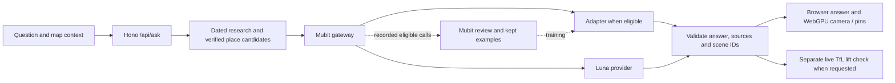
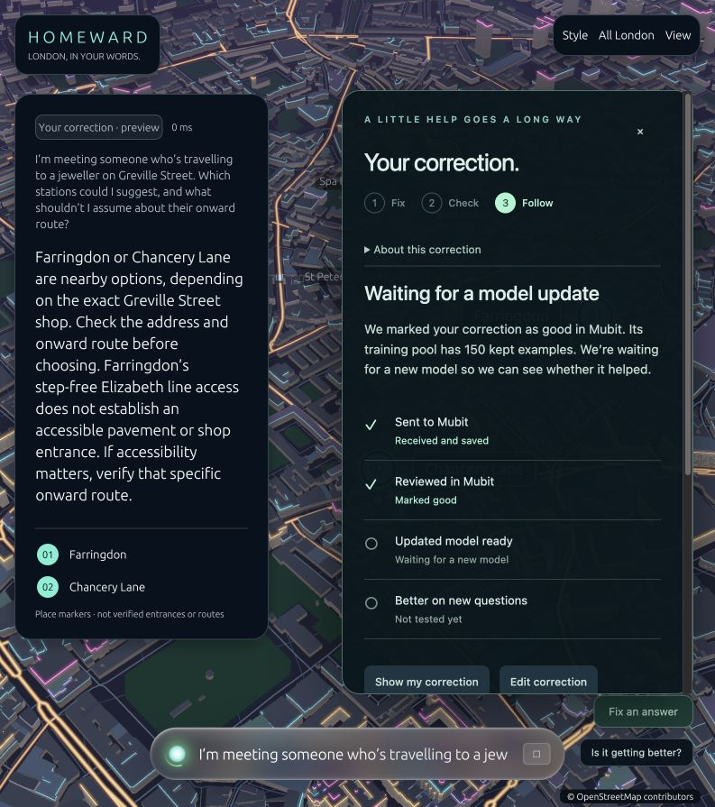

# Homeward — London, in your words

A conversational London travel assistant on a full-screen **WebGPU map**. Ask about step-free stations, museum visits, payment rules or getting home late; Homeward answers from dated source evidence and brings the relevant places into view.

Built for the Mubit hackathon to explore a recurring task: turn an operator's travel knowledge and corrections into a task-adapted open model. The intended benefit is owning an intelligence layer that can evolve with the product. Model quality, independence, latency and cost must be demonstrated rather than assumed.


This repository contains the **browser/WebGPU version**, its Node backend, teaching experiments and evaluation code. The renderer is supplied as precompiled WebAssembly with JavaScript bindings. No native desktop application, Rust source or Rust toolchain is included or required to run this distribution.

## Run locally

Requirements: Node.js 22 or later and a desktop browser with WebGPU and hardware acceleration. Use `localhost` or HTTPS.

```bash
git clone https://github.com/owenb/mubit_hackathon.git
cd mubit_hackathon
npm ci
cp .env.example .env
# Add your Mubit inference key to .env, then:
npm run build
npm start
```

Open **http://localhost:3000**. The map loads without model credentials; asking questions requires a working Mubit inference key and provider access. The server uses `PORT` when set, otherwise port 3000.

```dotenv
MUBIT_API_KEY=YOUR_MUBIT_INFERENCE_KEY
MUBIT_BASE_URL=https://api.mubit.ai/openai/v1
```

Use a key created for your own Mubit project. Configure starter credit or your provider key in the Mubit console. An optional `OPENAI_API_KEY` in `.env` is used only by the separate direct-provider baseline scripts; it does not configure the provider key in Mubit. Normal Homeward inference explicitly requests **gpt-6-luna** through Mubit.

Try:

- “Is there step-free access at Bank station?”
- “Can I touch in with my phone and touch out with my watch?”
- “Suggest two free indoor museums for a rainy afternoon.”
- “Does Night Tube run on Tuesday?”

## How it works



**Research and grounding.** The backend retrieves relevant facts from a local, dated research collection. It preserves exceptions and source links, distinguishes general guidance from live conditions, and refuses to present expired research as current. This is a hackathon knowledge snapshot, not an automatically maintained travel database. Research preparation is in `homeward/scripts/prepare-travel.mjs`; refresh sources honestly and review changes before updating dates.

**Map control.** The model returns a strict JSON answer containing `response_kind`, `static_access`, `source_ids` and a `scene`. A scene selects `keep`, `focus` or `fit`, plus verified catalogue IDs and place roles. The backend validates IDs and camera constraints before drawing. The model never invents coordinates. Station markers represent locations, not audited accessible entrances or routes.

**Live information.** Current lift questions trigger a separate TfL disruption-feed request. A missing outage notice does not guarantee that a lift works. Departure times, bookings and complete accessible journeys are not independently verified by this prototype.

**Serving provenance.** The UI distinguishes positively identified **Luna via Mubit**, an unverified route and a saved answer. A Mubit receipt proves the gateway handled a request; it does not prove a trained adapter answered. Invalid answers are retained as rejected attempts, and any one-off recovery is labelled separately.

**Learning.** Normal app calls use full Mubit recording and may become kept training examples after Mubit review. Stable instructions, model and output schema keep examples grouped into one task. Feedback and corrections are evidence for an update, but saved feedback alone does not establish that an adapter learned it. Metadata-only evaluation calls keep question/answer content out of Mubit teaching records.

## Correct answers and map pins

Open **Fix an answer**. The three steps are **Fix → Check → Follow**: edit what Homeward should say, choose the right places, preview your changes on the real map, then send a reusable correction or keep a personal trip edit local. Receipts and raw replies sit under **How we know**.

A real Greville Street correction removed Canary Wharf DLR and kept Farringdon and Chancery Lane. The corrected teaching reply was retained in Mubit under the original Homeward task, marked trainable, and positively reviewed. Its task pool rose from 149 to **150 kept examples**. A per-row kept flag and weight inclusion are not exposed, so the UI distinguishes that progress from a completed model update.

**Only v1 is visible; no trained improvement is proved yet.** Six fresh development questions were frozen and tested without an operator target. V1 produced five retained replies; only **1/6** passed the answer/map contract, with one interrupted call kept as a failure. These playground diagnostics do not establish a general accuracy score or a controlled Luna comparison. Inputs remain private and out of teaching for an eventual matched old/new run. The final 20 questions remain untouched.

See [the learning workflow](homeward/LEARNING.md), [timestamped Mubit observations](homeward/data/feedback-observations.json) and [development summary](homeward/data/development-learning.json). The updated UI shows the last verified check; it does not invent a trained state or trigger retraining.

Corrections persist under ignored `homeward/results/feedback/`, scoped to the browser session. Persist that directory when deploying. Real API keys, raw personal correction stores and development test payloads are excluded.



## The WebGPU city

The complete London map contains **183,550 source features**, producing **5,121,079 vertices** and **8,813,310 indices**. No map geometry was simplified for the browser.

- Source database: **21,910,636 bytes**.
- Lossless Brotli map transfer: **7,992,181 bytes**.
- Gzip WebAssembly engine: **2,376,832 bytes**.
- Combined map/engine transfer: about **10.37 MB**, before the small page and bindings.
- Expanded GPU geometry: about **199 MB**; this targets desktop hardware.

A worker verifies and assembles map geometry; the renderer uploads buffers in bounded chunks. Loading stages report actual download bytes, completed geometry layers and GPU upload bytes, with indeterminate progress where measurement is unavailable. Content-hashed assets are verified before use and cached in the browser.

`npm run build` verifies the bundled map/engine checksums and rebuilds the editable HTML/CSS/JavaScript shell. The compiled renderer is a supplied artifact; this distribution does not rebuild that engine from source.

## Current model results — 24 October 2026

This is a working product prototype with an unfinished adaptation experiment. **We have not demonstrated that Mubit beats Luna.**

| Observation | Result |
| --- | --- |
| Recorded Homeward task calls | 183 |
| Kept examples | 150 |
| Real trained adapter | Qwen3-4B PEFT v1 |
| Mubit recorded-reference gate | 1/12, or 8.3% |
| Latest observed rollout | 10% silent testing; zero graded pairs |
| Verified ordinary adapter API serving | Not established |
| Existing adapter v2 | Not started at the last check |
| Frozen final 20-question comparison | Not run |

A four-case **development diagnostic** compared the selected v1 playground adapter with positively identified Luna API replies, using identical evidence per pair:

| Manual assessment | Adapter v1 | Luna |
| --- | ---: | ---: |
| Core advice acceptable | 2/4 | 4/4 |
| Complete task acceptable, including map | 1/4 | 3/4 |

These are known development cases, assessed without blinding. Playground/API generation settings differ, and the night-answer rubric nuance is documented. These results are not the final benchmark, evidence of general model superiority, or a measured cost/latency comparison. See the [development report](docs/evidence/v1-development-report.json) and [readable findings](docs/evidence/v1-development-summary.txt).

The task History records a separate refresh policy of every 24 hours after 25 new rated-up rows. The scheduler cursor and exact next training time are unknown. No supported self-service early-refresh action was found. Manual rollout controls affect all calls in a task, so they were not applied under the requirement to isolate tests from the app. See the [backend investigation](docs/evidence/v2-self-service-investigation-2026-10-24.json).

The isolated [decision lab](homeward/experiments/decision-lab/manifest.json) prepares 40 compact evidence/place-selection examples around observed failures. It has **not been submitted or integrated into the app**. It would create a separate task whose first adapter starts at v1, not v2 of the original model.

## Evaluation and tests

```bash
npm test
```

Tests use injected model/feed responses and local assets, so they do not consume inference credit. They cover freshness, typed map IDs, camera rules, cache behaviour, provider identity, API validation, lossless map integrity, serving gates, version consistency and blinded-review formatting.

The final 20 questions and grading rubrics remain private to preserve the existing held-out evaluation. Their checksum is `a8a19175c5ec7b3b0309b897ef4c92ddf19f797634ad141f6f3b19e6b01abe91`. The public checkout skips the private-file integrity test when that file is absent; all fixture-based evaluation tests still run. The evaluation UI shows the pending state and never fills missing scores with invented results.

A valid final run requires attributable fixed-version adapter inference and an identified Luna comparator, identical evidence/settings, no answer cache or recovery, metadata-only Mubit recording and retained failures. The harness stops before sending final questions if serving proof is missing. No final benchmark or paid teaching batch runs at startup or during `npm test`.

## Repository guide

| Path | Purpose |
| --- | --- |
| `homeward/web/public/` | Editable browser shell, loader, worker and evaluation/correction overlays |
| `homeward/web/dist/` | Runnable browser distribution, compiled renderer and complete map |
| `homeward/web/app.mjs` | Hono routes and static-asset serving |
| `homeward/src/core.mjs` | Grounding, Luna calls, validation, cache and live lifts |
| `homeward/src/map-contract.mjs` | Place catalogue lookup and validated scene contract |
| `homeward/src/feedback.mjs` | Session-owned corrections, validation, Luna audit and teaching receipts |
| `homeward/src/inference.mjs` | Conservative serving identity and metrics |
| `homeward/src/evaluation*.mjs` | Paired collection, serving gates and review |
| `homeward/src/demo-evidence.mjs` | Judging-criteria evidence and honest demo status |
| `homeward/data/` | Research snapshot, place catalogue, teaching/development data and status |
| `homeward/experiments/decision-lab/` | Prepared isolated successor experiment |
| `docs/evidence/` | Selected development results and backend investigation |
| `scripts/experiment.mjs` | Original synthetic gateway experiments and optional direct baseline |

Correction endpoints are documented in [the learning workflow](homeward/LEARNING.md). Useful endpoints: `GET /health`, `POST /api/ask`, `GET /api/metrics`, `GET /api/evals`, and `GET /api/demo-evidence`.

## Container deployment

```bash
docker build -t homeward-webgpu .
docker run --rm -p 3000:3000 --env-file .env homeward-webgpu
```

The container runs Node as a non-root user and uses the bundled browser assets. Set runtime secrets on your host, expose the `PORT` supplied by the platform and use `/health` as the healthcheck. The inference endpoint is intended for a controlled demo; add authentication and usage controls before allowing unrestricted public model calls. Publishing this repository does not deploy a public app.

## Data, attribution and credentials

Map data is **© OpenStreetMap contributors**, distributed under [ODbL 1.0](https://opendatacommons.org/licenses/odbl/1-0/). Attribution remains visible. The complete derived map and its notice are served at `/maps/london.ael` and `/maps/README.txt`; see [the format documentation](docs/LONDON_DATA.md). The place catalogue is derived from the same database. Travel facts link to their original sources and retain their retrieval dates.

Only an empty `.env.example` is included. Real `.env` files, credentials, caches, raw private logs, private final questions and native build products are excluded. API keys remain on the server; the browser never receives them.
