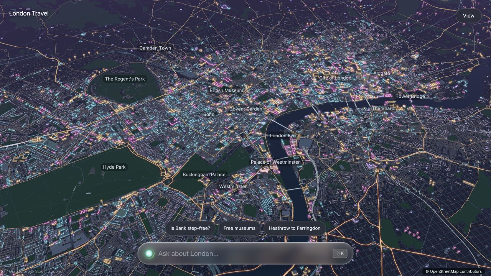
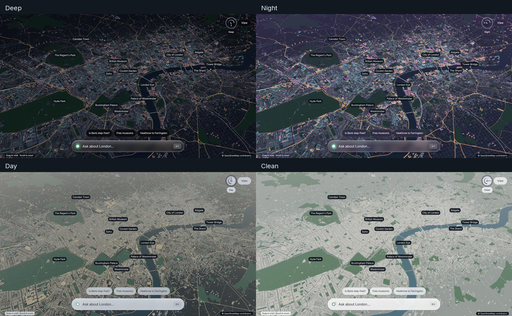

# Homeward / London Travel — London, in your words

## 🔴 Live demo: [london-guide-production.up.railway.app](https://london-guide-production.up.railway.app)

Open in desktop Chrome or Edge (WebGPU required). The full city map takes about 20 seconds on first load.

---

A conversational London assistant on a full-screen **WebGPU map**, with two modes in the same interface:

- **Travel:** ask about step-free access, museums, payment rules or getting home late; see dated sources and the relevant map places.
- **Businesses:** explore seven verified London enterprise offices, assess a possible recurring LLM workload for Mubit, and correct the proposed fit or pitch. Public evidence, estimated uses and unknowns stay separate.

Built for the Mubit hackathon around **expert correction → reviewed example → task-adapted open model → fresh-question test**. The product and correction flows work. Several isolated models have trained, but **we have not demonstrated that Mubit beats Luna overall** or that an adapter serves ordinary app traffic. Current app assessments request Luna through Mubit.

For a new coding agent, read [AGENTS.md](AGENTS.md) first. It contains the exact model/task IDs, constraints, private evidence locations, completed work and next steps. The latest backend checkpoint is 24 October 2026, 20:14 BST; status files are observations, not live platform health.



## Why this matters to travel operators

A great travel guide's advantage is the “secret knowledge” built over years: how the city really works, what visitors love, and which recommendation fits this particular person. That expertise lives in guides' heads and comes through in many small decisions every day.

London Travel gives operators a way to teach that judgement. A guide can correct an answer or move a map pin; Mubit can turn reviewed examples of this recurring task into updates to a task-adapted open model. The ambition is an intelligence layer that carries the operator's expertise and improves through their corrections.

For an operator, the reasons to pursue this are:

- **Sovereignty of data.** With exported weights and self-hosted inference, operators could choose where traveller requests and their proprietary knowledge are processed, subject to their own retention and access policies.
- **Ownership.** Build a model shaped by years of local expertise, with weights the operator can export and retain as a business asset.
- **Reliability.** Use versioned models and repeatable evaluations to check that familiar travel questions receive useful answers and correct map pins. Keep changing facts, such as lift outages, in fresh evidence and live feeds.
- **Optionality — including running locally.** Export provides a path to serving on suitable local hardware or a chosen hosting provider, and to changing infrastructure as requirements change.
- **A degree of resistance to future censorship.** Retained, independently served open weights reduce dependence on a closed provider's future access restrictions, regional availability and refusal policies. They do not remove legal or infrastructure constraints.

The current prototype uses hosted Mubit for recorded teaching calls. Export and self-hosted inference remain unverified. A narrow Bank correction changed a later trained-model answer, but overall answer acceptance did not improve; the results below separate that observation from the longer-term ambition.

## Potential customers

- **Citymapper:** conversational help inside a journey-planning app, combining transport knowledge with recommendations and the right map locations.
- **London hotels and concierges:** a digital extension of the concierge team's local expertise, with staff corrections teaching the recommendations they want to give guests.
- **Theatre websites:** practical advice around a visit, such as arrival stations, nearby places to eat and getting home after the show, grounded in current venue and transport information.

These are prospective customer groups, not existing customers or partnerships.

## Run the browser distribution

This Git repository contains the browser/WebGPU version, Node backend and selected experiments. Its renderer is precompiled WebAssembly with JavaScript bindings. **No native application, Rust source or Rust toolchain is needed** to run this distribution.

Requirements: Node.js 22+, a desktop browser with WebGPU/hardware acceleration, and localhost or HTTPS.

```sh
git clone https://github.com/owenb/mubit_hackathon.git
cd mubit_hackathon
npm ci
cp .env.example .env
# Fill the keys privately, then:
npm run build
npm start
```

Do not replace an existing `.env`. Open **http://localhost:3000/**; choose **Businesses** or open **http://localhost:3000/enterprise**. The map loads without credentials. Questions require a working Mubit key and provider access. `PORT` overrides 3000.

Travel uses `MUBIT_API_KEY` and `MUBIT_BASE_URL=https://api.mubit.ai/openai/v1`. Businesses requires a separate `ENTERPRISE_MUBIT_API_KEY`; the authorized local demo can instead use `BANK_DEMO_MUBIT_API_KEY` from the private `.env.bank-demo`. There is deliberately **no enterprise fallback to the travel key**. Add the enterprise variable privately to `.env` on a fresh setup, or start the existing local setup with:

```sh
PORT=3000 node --env-file-if-exists=.env --env-file-if-exists=.env.bank-demo homeward/web/server.mjs
```

Both modes explicitly use **gpt-6-luna**. Configure starter credit/provider access in the Mubit console. `OPENAI_API_KEY` is optional for historical direct-baseline scripts only; adding it locally does not configure Mubit's provider key. Direct OpenAI mode is not used by the product or demo. Secrets remain on the server.

Try “Is there step-free access at Bank station?”, “Can I touch in with my phone and touch out with my watch?”, or select a business and ask which narrow recurring task would make a useful Mubit pilot.

## How it works

**Ground the answer.** The travel backend retrieves a local, dated research snapshot and verified map candidates. It does not search the web on every request. Expired evidence is not presented as current. Current lift questions use a separate TfL disruption feed; no notice is not a guarantee that a lift works. Complete accessible journeys, bookings and live departure times are not verified by this prototype.

**Control the map.** The model returns a strict JSON answer and scene: a camera command plus up to six catalogue IDs and place roles. The backend validates them and the renderer resolves coordinates. A station pin does not establish an accessible entrance or route. The learned task is selecting places/actions from evidence, not learning the London geometry itself.

**Keep enterprise claims honest.** Businesses uses actual OSM office objects for Morgan Stanley, Barclays, HSBC, J.P. Morgan, Unilever, Shell and Google. Six licensed Wikimedia photos accompany the cards; J.P. Morgan has a monogram fallback. The requested cap was 30, not a target. Public AI evidence does not prove private LLM usage, spend or adoption by a particular London office. No business outreach is performed.

**Keep model identity visible.** The UI distinguishes positively identified Luna via Mubit, an unverified route and a saved answer. A gateway receipt is not adapter-serving proof. Normal travel calls use full recording; business assessments use metadata-only recording. Evaluation inputs must stay out of teaching.

## Correct an answer or map pin

Choose **Fix this** beneath an answer. Add/remove verified places and use **Edit wording** to correct the text. **Use on my map** saves a personal edit. **Share as a correction…** asks for a reason and explains the Luna audit and teaching calls before **Send correction**. A successful submission shows a receipt, not an automatic claim that the model learned.

In Businesses, use the same answer card and editor to save a local correction, then explicitly **Teach this judgement**. This makes a full-recorded Luna teaching call under the separate enterprise task. Concurrent duplicate submissions coalesce; ambiguous failures are retained without automatic retry. The latest real Unilever and Shell flows produced teaching receipts, which remain inspectable after reload.

The shared **Evidence** panel holds source dates, corrections, model results and renderer measurements. The ask bar retains your exact draft. Travel and business histories stay separate across mode changes. There is no separate enterprise app or sidebar.

The travel correction pipeline audits with recording off, then supplies the accepted target in a recorded teacher request. **Luna reproducing that target is submission fidelity, not generalization.** Stored content, Good review, kept example, trained version and improved fresh answer are different stages. The original Greville Street pin correction reached stored/trainable content and a saved Good rating; exact per-row weight inclusion is not exposed.

See [the learning workflow](homeward/LEARNING.md) and [enterprise implementation/evidence](homeward/experiments/enterprise-prospecting/README.md). Travel records live privately in `homeward/results/feedback/`; enterprise records in `homeward/experiments/enterprise-prospecting/results/interactions/`. Persist them on writable private storage. Session cookies provide ownership scoping, not full multi-user authentication.

## What the trained models actually did

All results below are dated development observations, not a final benchmark. Internal Mubit exams differ across tasks and must not be compared as one learning curve. Preview/API decoding and schema settings are not proven identical; reviews were non-blinded and not independent expert assessment.

| Experiment | Internal Mubit check | Fresh development result |
| --- | --- | --- |
| Original travel v1 | 1/12 (8.3%) | Original pin-correction baseline: 1/6 valid full answers/maps, including one interrupted failure |
| Corrected-guide isolated v1 | 4/12 (33.3%) | Adapter: 3 pass, 1 uncertain, 2 fail; Luna: 5 pass, 1 uncertain |
| New isolated Bank v1 | 5/12 (41.7%) | Answers stayed 2/6 → 2/6; full answer/classification/map improved 0/6 → 2/6 |
| Enterprise v1 | 11/12 (91.7%) | Semantic 2 pass, 1 uncertain, 3 fail; only 1/6 valid format; full task 0/6 |

The Bank comparison did produce a useful learning moment: a fresh question about Waterloo & City to DLR interchange gained the supported 290-metre street-and-lifts detail and a correct Bank focus command. But control answers regressed, so the overall answer count did not improve. The old and new models had different training sets; no per-row inclusion manifest or matched retrain without the correction establishes causality. The capture-reconstruction limitation is recorded in the experiment evidence.

Enterprise's strong internal score did not translate into six reliable app-format answers. A separate explicit-schema diagnostic improved format and is excluded from those six results. Its Luna diagnostic accepted 3/6 complete tasks, retaining one transport failure; it was not a controlled superiority test. The app continues to use Luna.

Original travel still had only v1 at its last verified check (153 kept, 10% silent testing, zero verified normal adapter traffic). The separate guide, Bank and enterprise models are **v1 of different tasks/projects**, not v2 of the original app. Fixed-version serving has been observed in Mubit **Try models**, not verified for ordinary app API traffic. No cost, latency or self-hosted-inference advantage is claimed.

Public supporting evidence: [original diagnostic](docs/evidence/v1-development-report.json), [corrected-guide report](homeward/experiments/corrected-guide-lab/results/paired-development-report.md), [enterprise raw results and status](homeward/experiments/enterprise-prospecting/observed-status.json). The Bank captures are private in the source workspace; exact locations and IDs are in [AGENTS.md](AGENTS.md).

## The unfinished next step: Bank round 2

**38 Luna teaching calls are already complete.** Audit recommends 26 Good and withholds 12. **None of those round-2 ratings has been submitted, no next version is verified, and no round-2 student test has run.** At the last check the console was signed out after an earlier engine outage; service recovery is unconfirmed. Gateway inference working did not establish that reviews/training worked.

After normal sign-in and console recovery, the next agent must verify exact receipt/task membership, capture the planned fresh v1 baseline, submit the 26 reviewed examples through supported controls, and observe a new training job/version before the after test. Six development inputs are already frozen. Last preview quota was 11, so the recorded plan is five matched before/after pairs plus one after-only question; do not compare unequal denominators. Do not rerun the paid teaching batch or delete its completion locks.

The first isolated Bank model trained automatically after 29 accepted examples. A nominal 25 was insufficient: Mubit exposed a calibration holdout minimum and a 28-accepted threshold. The old travel task separately recorded a 24-hour/25-new-rated-row refresh policy; the current Bank refresh cursor is unknown. [Mubit's first-adapter guide](https://docs.mubit.ai/guides/first-adapter), last checked 24 October, says there is no retry-training button. No supported force-refresh API was found. Rollout controls change serving, not training, and were not applied to the app.

## Response headers and protected evaluation

Every backend Mubit HTTP attempt, including errors, is journalled with redacted response headers under ignored `homeward/results/mubit-headers/`. No prompt/answer bodies or outbound credentials are stored in that journal. `npm run homeward:headers` reads it without an API call. New model-identity fields are preserved but must have a confirmed meaning before they establish adapter/version proof. No new adapter identity header was seen in Bank round 2.

**The final 20 questions remain private and untouched.** Their SHA-256 is `a8a19175c5ec7b3b0309b897ef4c92ddf19f797634ad141f6f3b19e6b01abe91`. Do not read, teach, edit or run them during development. An eventual final run requires explicit authorization, attributable fixed-version inference, an identified Luna comparator, identical evidence/settings, metadata-only recording, no answer cache/recovery and retained failures. The harness fails closed without serving proof.

## Light, from night to day

The circular **Light** dial in the top-right corner turns continuously through 270°: deep, night, day and clean. Drag around the ring, use arrow keys for fine adjustment, or Home/End for the extremes. All three sections of its travel change the map, glass and accent light: deep black to cosmic violet, night through daylight, then natural materials to a clean white city. It follows the system appearance until you choose a value. The dial remembers your last choice locally. Lighting has no additional menu controls.



Aether’s date-aware London sun path drives sky brightness, warmth and stars. One Rust frame value updates the WebGPU map, ask bar and HTML panels together. Hand changes settle with exponential easing; system changes take three seconds per unit. Surface colours blend in linear light; text switches RGB at one-quarter UI daylight instead of fading through grey. Reduced-motion preferences skip the transition. Map labels and raw evidence retain contrasting dark plates. The full map and typed ask-bar text remain intact.

## The WebGPU city

The complete London map contains **183,550 source features**, producing **5,121,079 vertices** and **8,813,310 indices**. No map geometry was simplified for the browser.

- Source database: **21,910,636 bytes**.
- Lossless Brotli map transfer: **7,992,181 bytes**.
- Gzip WebAssembly engine: **2,353,454 bytes**.
- Combined map/engine transfer: about **10.34 MB**, before the small page and bindings.
- Expanded GPU geometry: about **199 MB**; this targets desktop hardware.

A worker verifies and assembles map geometry; the renderer uploads buffers in bounded chunks. Loading shows a rotating London Eye and “Loading London...”. Actual download, geometry and GPU upload measurements remain available in Evidence. Content-hashed assets are verified before use and cached in the browser.

`npm run build` verifies the bundled map/engine checksums and rebuilds the editable HTML/CSS/JavaScript shell. The compiled renderer is a supplied artifact; this distribution does not rebuild that engine from source.

## Verify without model calls

```sh
npm test
npm run homeward:headers
```

Handoff check on 24 October: **78 tests passed, one expected private-file checksum test skipped**, zero failures. The full source workspace passed 79/79 including that byte-checksum test. Tests use injected model/feed responses and local assets, with no paid inference. No teaching batch or benchmark runs at startup. The skipped test does not mean the private final questions are bundled here.

## Repository guide

| Path | Purpose |
| --- | --- |
| `AGENTS.md` | Complete cross-agent handoff, exact identities, evidence and resume order |
| `homeward/web/public/` | Editable shared WebGPU shell, worker, map modes and correction UI |
| `homeward/web/dist/` | Built shell, full map and compiled renderer |
| `homeward/web/app.mjs` | Hono APIs and static serving |
| `homeward/src/` | Grounding, validation, corrections, telemetry, enterprise service and evaluation |
| `homeward/data/` | Dated research, verified place catalogue and observed evidence snapshots |
| `homeward/experiments/corrected-guide-lab/` | Completed isolated model and development report |
| `homeward/experiments/enterprise-prospecting/` | OSM company data, photos, contract, trained-model evidence and UI handoff |
| `docs/mubit-notes.md` | Earlier gateway/documentation research |
| `scripts/experiment.mjs` | Historical synthetic support-ticket experiments; optional direct baseline, outside the demo |

Useful routes: `GET /health`, `POST /api/ask`, `GET /api/metrics`, `GET /api/evals`, `GET /api/demo-evidence`, `GET /api/enterprise/companies`, `POST /api/enterprise/assess`, `GET /api/enterprise/status`. See the learning/enterprise docs for correction routes.

## Deployment status

Local Node execution is the verified path. **The existing Dockerfiles need a packaging fix before deploying the integrated app:** they omit the enterprise experiment's imported runtime contract/catalogue assets, and do not provision its default writable interaction directory. Copy only the required public runtime data/assets, provide private writable storage for both correction services, and smoke-test the built container before treating it as deployment-ready. Publishing this repository does not deploy a public app.

The service listens on `0.0.0.0:$PORT`; `/health` is its healthcheck. Keep credentials as runtime secrets and add authentication/usage limits before exposing unrestricted paid inference.

## Data and attribution

London map and office geometry: **© OpenStreetMap contributors**, [ODbL 1.0](https://opendatacommons.org/licenses/odbl/1-0/). Attribution remains visible. The complete derived map and notice are served at `/maps/london.ael` and `/maps/README.txt`; see [the map format](docs/LONDON_DATA.md). Company photo creators/licences are retained in `homeward/experiments/enterprise-prospecting/images.json`. Travel facts retain source URLs and retrieval dates.

No API keys are documented or added by this handoff. Environment files, private logs, session stores and the final questions must remain outside Git. Selected reviewed synthetic evidence is included; Bank private captures and raw app corrections are not. The cancelled scheduled monitor stays cancelled: console checks occur only during active work, and stop when sign-in expires.
