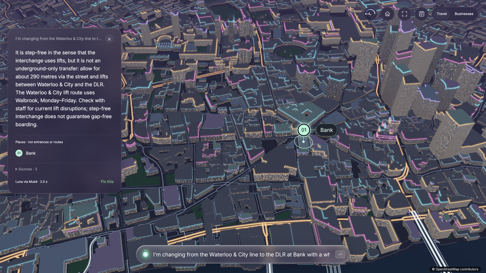
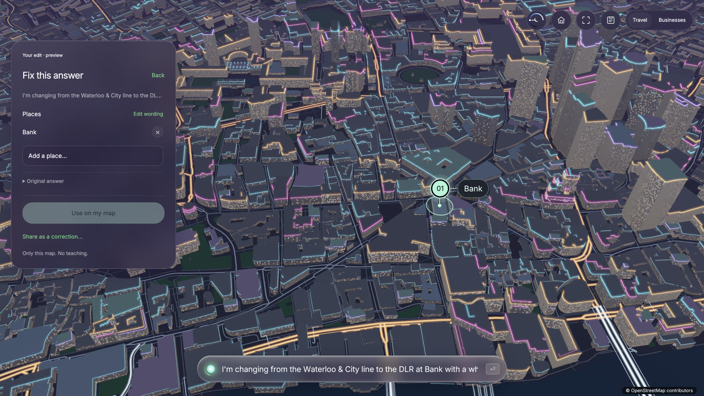
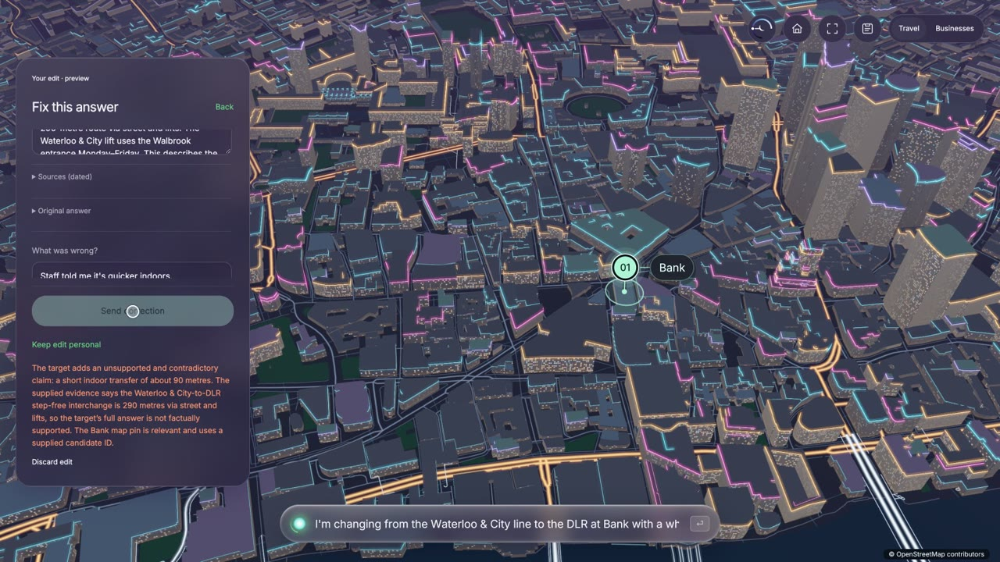
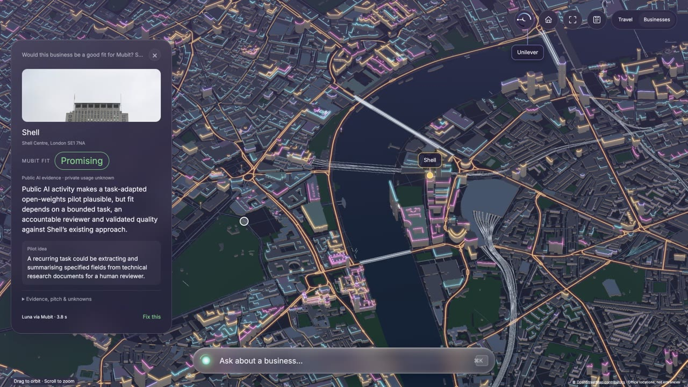
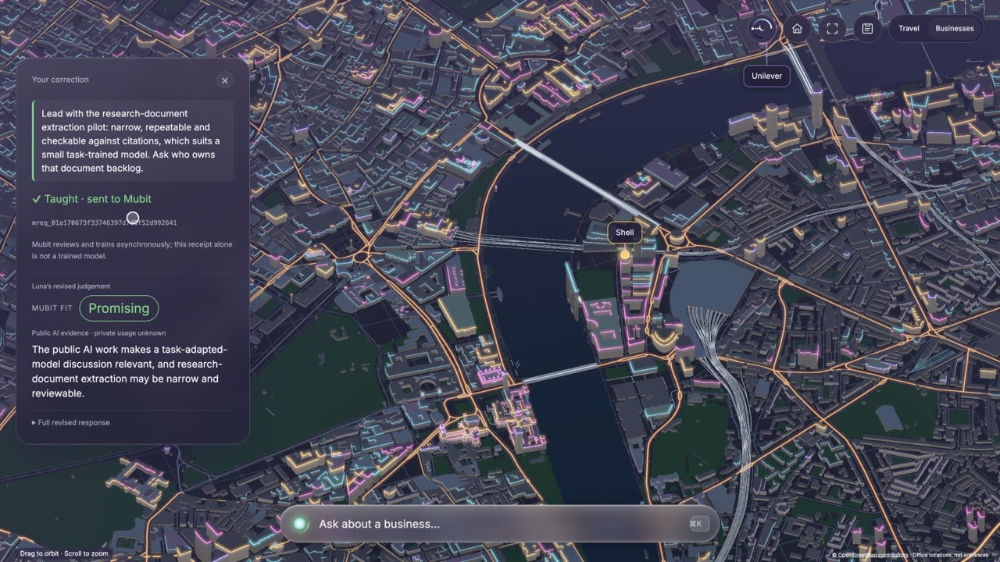
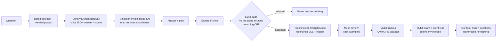
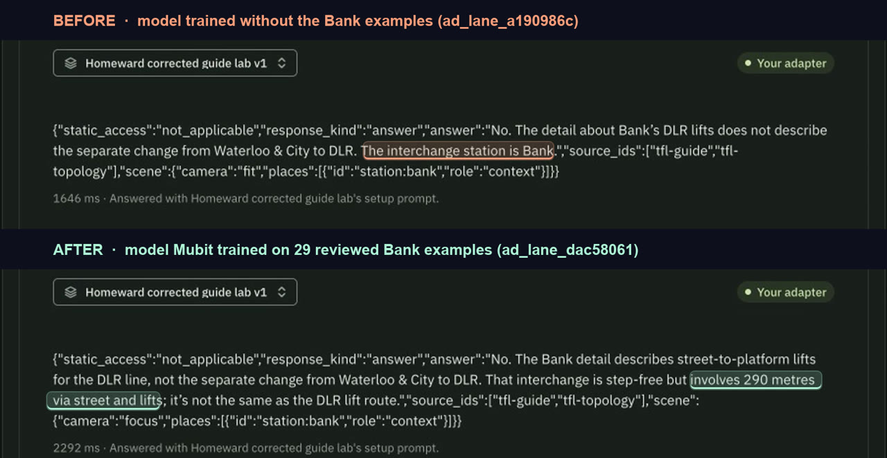
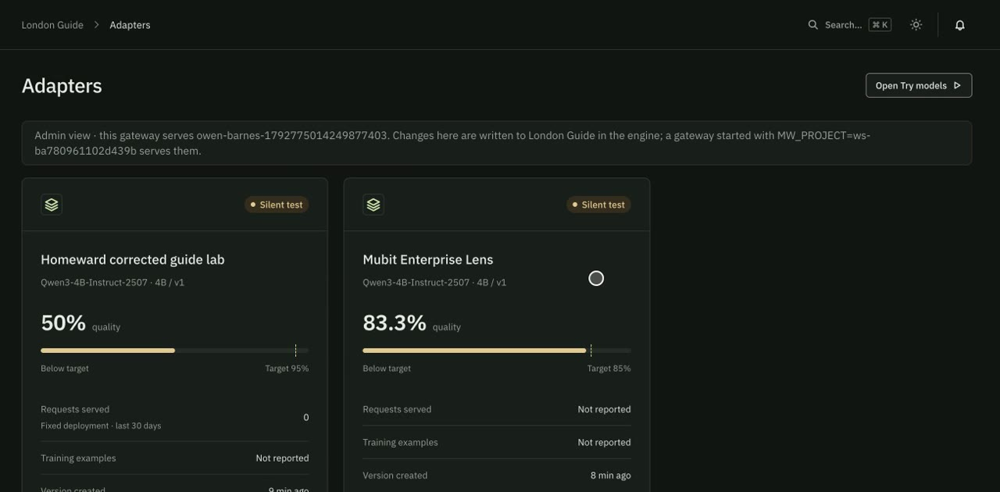
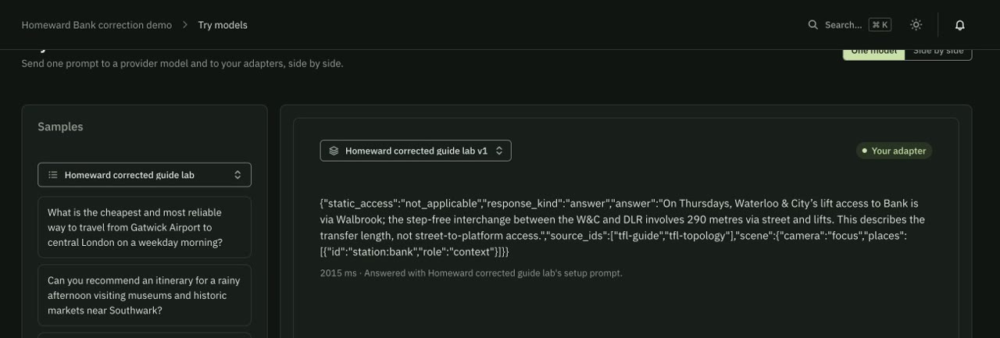

# London Guide: a London assistant that learns from its experts, built on Mubit

## 🔴 Live demo: [london-guide-production.up.railway.app](https://london-guide-production.up.railway.app)

Open in desktop Chrome or Edge (WebGPU required; other browsers get a screen saying where it works). The full city takes about 20 seconds to load the first time.



---

## In one minute

- **What it is.** A conversational guide to London on a live 3D map of the whole city, with two jobs in one interface:
  - **Travel** answers questions such as step-free routes, payment rules and getting home late.
  - **Businesses** judges which London companies would be good Mubit customers.
- **The idea.** A business's most valuable training data is its experts correcting the AI as they work: a concierge fixing an answer, an accessibility specialist moving a pin, a salesperson sharpening a pitch. London Guide captures those corrections inside the product, **checks each one against the evidence**, and sends only the good ones to **Mubit**. Mubit turns them into a small open model for that job.
- **What actually happened (24–25 October 2026):**
  - **Bad corrections are refused.** An edit claiming Bank's Waterloo & City to DLR change is "a short indoor transfer of about 90 metres" was refused, because the sources say 290 metres via the street and lifts. An evidence-backed fix was accepted and sent to Mubit with a receipt.
  - **Mubit trains a model with no ML team.** Once 29 reviewed examples were kept, Mubit trained a **Qwen3-4B adapter on its own, in about 10 minutes**, with no training code.
  - **The retrained model gives a better answer.** We asked a Bank question that was frozen before training and never taught. Our earlier model said no, but left out the 290-metre street-and-lifts route, even though its sources included it. The model Mubit trained on 29 reviewed Bank examples added it. On 25 October we re-ran both live in Mubit for the demo video, one attempt each. Each gave the same reply, word for word, as on 24 October. This is one question, not an overall win.
  - **Mubit gates every release.** The business model scored 91.7% against an 85% target and Mubit **promoted it to 10% of traffic automatically**. Lower scorers stay in silent testing.
  - **The loop keeps running.** In a fresh project, 109 teaching calls and 80 audited examples produced **two new open models**, travel and business, now graded and held in testing.
- **Honest status.** The trained models are **not yet better than Luna overall**. The numbers, including the losses, are below.

---

## The problem

The advantage of a great guide, concierge or transit team is **nuance built up over years**. At Bank station, "step-free" for a Waterloo & City to DLR change means **290 metres via the street and lifts, through the Walbrook entrance, Monday to Friday**. A generic AI either misses that detail or states it too confidently.

Experts notice and fix mistakes like this every day, but today those fixes are lost: a hosted model never learns from them. Naively "learning from feedback" is also dangerous, because one confident wrong correction can teach a model something false. For accessibility information that is a real harm.

London Guide is built around one loop: **expert correction → evidence check → teaching example → trained model → tested on new questions**.

---

## What you can do in the app

### Travel
Ask a real question, such as *"I'm changing from the Waterloo & City line to the DLR at Bank with a wheelchair. Is that interchange step-free, and how far is it?"* The answer arrives in a few seconds. It cites dated TfL sources, and the camera flies to the verified station pin.

Under any answer, **Fix this** lets you edit the wording or the pins. **Use on my map** keeps the edit private. **Share as a correction** sends it through the evidence check, and then, if it passes, to Mubit.

If Mubit or the model fails, the app says so in plain words, such as *"Mubit, the service that runs our AI, didn't answer just now"*, and offers **Try again**. The raw error stays in the server log. Browsers without WebGPU get a screen that says which browsers can draw the map.





### Businesses (the twist)
The same engine, a second job: **which London firms should buy Mubit?** Seven real London offices come from OpenStreetMap: Morgan Stanley, Barclays, HSBC, J.P. Morgan, Unilever, Shell and Google. Click one and Luna gives a **Mubit fit** verdict (promising, conditional, weak or unknown), a one-line reason and a pilot idea. Public evidence, hypotheses and unknowns are kept apart.

A sales expert can **Fix this judgement** and **Teach** it. The correction goes to Mubit as a training example for a separate business model. In our run, Shell came out **promising**: a narrow, repeatable task of extracting key fields from research documents, with a reviewer checking the citations. Google came out **weak**. Barclays, HSBC, J.P. Morgan and Unilever were **conditional**.





---

## How it works, end to end



1. **Grounded, structured answers.** Each question is sent with a dated research snapshot (TfL guidance with retrieval dates) and a catalogue of verified map places. Luna, called through **Mubit's OpenAI-compatible gateway**, must return strict JSON with these fields:
   - `answer` and `response_kind`.
   - `static_access`, the access classification.
   - `source_ids`.
   - `scene`: a camera command plus up to six catalogue place IDs with roles.

   The backend validates every ID and the map resolves coordinates. **The model never invents a place or coordinate.** That makes every answer checkable, and the task learnable by a small model.
2. **Corrections where the work happens.** Experts edit the answer text or add and remove verified places. A correction carries a reason ("what was wrong").
3. **The evidence gate.** Before anything can teach the model, Luna audits the corrected answer against the same dated sources. **Mubit recording is off for the audit**, so the audit itself never becomes training data. Refused corrections stay out, and the UI explains why. Every attempt is kept.
4. **Teaching through Mubit.** Each accepted correction is sent as a **fully recorded** teaching call, using the app's own task instructions and answer schema, so Mubit files it under the same task as normal traffic. The app shows the Mubit receipt (`mreq_…`).
5. **Mubit reviews and trains.** Mubit groups calls into tasks and keeps reviewed examples. When enough are kept, it **starts training on its own**: we observed it needs 28 (at least 12 held out for its exam, plus at least 13 to train on). It produces a **Qwen3-4B PEFT adapter** for that task.
6. **Mubit gates release.** Each version is graded on held-out examples, by agreement with the teacher's answers, then placed in a **silent test**. It is promoted only when it meets its target. Our business adapter passed (91.7% against 85%) and Mubit promoted it to 10% of traffic. The travel adapters have not passed yet, and stay in testing.
7. **Our own test on new questions.** Development questions were written and frozen **before** training and never taught. A separate private 20-question final set has never been used. Its SHA-256 is checked in tests and the file is not in this repo.

**Businesses uses the same loop** with its own system prompt, schema, task and adapter:
- Assessments are recorded as metadata only.
- Only an explicit **Teach this judgement** records a full teaching example.

**Every model call goes through Mubit.** Answers, audits, teaching calls and business assessments all use `https://api.mubit.ai/openai/v1`, and the travel client refuses any other host. The only direct-OpenAI path is an old, optional comparison script (`scripts/experiment.mjs --direct`, `npm run baseline`). The app and the demo never use it.

**Every Mubit HTTP call** is journalled with safe response headers (no prompts, answers or keys), and the UI shows which model actually answered.

---

## What's new here

1. **Corrections are the training signal, captured in the product.** There's no separate labelling project. Training data is a by-product of experts doing their job.
2. **Learning is evidence-gated.** An auditor checks every correction against sources before it can teach the model. We watched it refuse a confident wrong edit and accept a precise fix. That's what makes "learn from users" safe for accessibility information.
3. **A small model can learn the answer format.** The model picks verified place IDs and a camera command, never geometry. The validator and renderer make every output checkable, and the task is narrow enough for a 4B model.
4. **One engine, several learnable jobs.** Consumer travel answers and B2B sales judgement run as separate Mubit tasks and adapters on the same product. The second job **finds customers for Mubit itself** and learns the sales team's judgement.
5. **Measured honestly.**
   - Frozen development questions and a protected final set.
   - Model identity recorded per call.
   - Evaluation that fails closed without proof of which model served.
   - Losses reported alongside wins.
6. **The whole city, unsimplified, in the browser.** 183,550 map features (5.1 M vertices) render with WebGPU. The app shows answers in place on a real London map, which makes the corrections tangible.

---

## Evidence: what actually happened

All results are dated development observations from 24–25 October 2026, not a final benchmark. Reviews were done by us (the coding assistant, with Luna's audit), not by independent experts.

| What we tested | Result |
| --- | --- |
| Wrong correction | "A short indoor transfer of about 90 metres" **refused**: the sources say 290 m via the street and lifts. |
| Evidence-backed correction | **Accepted**, sent to Mubit as a recorded teaching example, receipt returned. |
| First correction-trained model (Bank task) | 29 reviewed examples kept → Mubit **started training on its own**, adapter ready in about 10 minutes. Mubit exam: 41.7% (5/12). |
| Same model, frozen Walbrook question it never saw | About 2 s in Mubit Try models: Walbrook for a Thursday, 290 m via street and lifts, Bank focused. Right for the question asked, but it didn't state the Monday–Friday limit our rubric asks for, so it's a **partial** pass. |
| Before vs after training, six frozen questions | Fully correct (answer + classification + map): **0/6 → 2/6**. Answers alone: 2/6 → 2/6, with control questions regressing. A targeted gain, not an overall win. |
| The clearest before/after: one frozen Bank question | Before: *"No. … The interchange station is Bank."* After: *"No. … That interchange is step-free but involves 290 metres via street and lifts."* **Re-run live on 25 October** in Mubit Try models, one attempt each, no retries: both replies matched the 24 October captures word for word. |
| Business model (Enterprise v1) | Mubit exam **91.7%** (target 85%) → Mubit promoted it to 10% of traffic. Our fresh full-format test: 0/6, so the app still uses Luna for business answers. |
| Fresh project, 24–25 Oct | 109 Luna teaching calls (73 travel, 36 business), 80 audited good examples → **two new Qwen3-4B models**: travel **50%**, business **83.3%**, both held in testing. |
| New travel model, all six frozen questions (one attempt each, strict rubric) | **1 full pass**: *"does step-free mean boarding is gap-free?"* (correct, about 3 s, Bank focused). **2 near passes. 3 fails**: an invalid map role, a wrong access classification, and one payment answer that contradicts itself. If you saw this question in a demo video, it is that one full pass, not a typical result. |
| Business fit verdicts | Shell **promising**; Google **weak**; Barclays, HSBC, J.P. Morgan, Unilever **conditional**. |







Public evidence in this repo:
- [Original travel diagnostic](docs/evidence/v1-development-report.json)
- [Corrected-guide paired report](homeward/experiments/corrected-guide-lab/results/paired-development-report.md)
- [Business model status and raw results](homeward/experiments/enterprise-prospecting/observed-status.json)
- [Learning workflow](homeward/LEARNING.md)
- [Business mode design and evidence](homeward/experiments/enterprise-prospecting/README.md)

The Bank and fresh-project captures stay in the private source workspace; exact IDs are in [AGENTS.md](AGENTS.md).

---

## Why this is a good use case for Mubit

- **A recurring, narrow task.** The same kinds of question arrive every day, with a fixed output format. This is exactly what a task-adapted small model is for.
- **Training data arrives on its own.** Concierges, support and accessibility teams already correct answers as part of their jobs.
- **Accuracy matters, so gating matters.** Mubit's held-out exams, silent tests and gradual rollout are what a business needs before letting a model answer accessibility questions.
- **The right split between model and live data.** The model learns judgement and phrasing, such as what "step-free" really means at a given station. Fast-changing facts like today's lift outages stay in live feeds.
- **It generalises.** The second job, B2B sales judgement, uses the identical loop. Any company with expert reviewers can adopt the same pattern.

## Commercial viability

- **Who would buy.** These are prospective customer groups; there are no partnerships:
  - Journey-planning apps (Citymapper).
  - Hotel groups and concierge services.
  - Theatres and venues advising visitors.
  - Tourism boards and accessibility services.
- **Why they would pay:**
  - Their years of local know-how become a model trained on their own corrections, and it keeps improving as their team works.
  - Mubit's versioned, gated releases make that safe to deploy.
  - Owning an open-weights model opens a path to self-hosting and data sovereignty. Mubit offers weight export; we have not tested it.
- **How it makes money.** A per-operator subscription for the correction loop, plus Mubit per-task training and inference. A 4B model may cost far less to serve than a frontier model; **we have not measured this**.
- **The moat.** Each operator's growing, audited corrections set is unique to them, and the model compounds with it.
- **For Mubit itself.** Businesses mode is a working prospecting tool. In our run it flagged Shell's research-document extraction as a promising first pilot, and it learns the sales team's judgement as they correct it.

## What we have not proven

- **Not better than Luna overall yet.** Gains are targeted (the Bank interchange nuance), and some control questions regressed.
- **Small samples:** six frozen development questions and Mubit's 12-check exams. Reviews were ours, not independent experts'.
- **Where the trained models served:** we observed fixed-version answers in Mubit's Try models. The app requests Luna via Mubit. Mubit has since started its own 10% partial rollout of the business adapter, and we have not verified which business answers that rollout serves.
- **Not tested:** weight export, self-hosting, and any cost or latency advantage.
- **The audit is model-based** and not perfectly consistent: the same correction can pass one run and fail another. Every attempt is recorded.
- **The live demo has no login** and runs on our Mubit credit.

---

## Try it

**Online:** [london-guide-production.up.railway.app](https://london-guide-production.up.railway.app). Desktop Chrome or Edge, with WebGPU. To see the screen that browsers without WebGPU get, add `?no-webgpu` to the address.

Things to try:
- *"I'm changing from the Waterloo & City line to the DLR at Bank with a wheelchair. Is that interchange step-free, and how far is it?"* Then **Fix this → Share as a correction**.
- *"Can I touch in with my phone and touch out with my watch?"*
- Switch to **Businesses** and click **Shell** or **Google**, then **Fix this → Teach this judgement**.

**Locally:** you need Node.js 22+, a desktop browser with WebGPU, and localhost or HTTPS. The renderer ships precompiled, so no Rust is needed.

```sh
git clone https://github.com/owenb/mubit_hackathon.git
cd mubit_hackathon
npm ci
cp .env.example .env   # only if .env doesn't exist; fill keys privately
npm run build
npm start
```

Open **http://localhost:3000/**, or **http://localhost:3000/enterprise** for Businesses. The map loads without keys; questions need Mubit access:
- Travel uses `MUBIT_API_KEY`, with `MUBIT_BASE_URL=https://api.mubit.ai/openai/v1`.
- Businesses needs its own `ENTERPRISE_MUBIT_API_KEY`. It deliberately never falls back to the travel key.
- Both modes use `gpt-6-luna`. Secrets stay on the server.

**Checks without paid calls:** run `npm test` and `npm run homeward:headers`. The tests use injected model responses and local assets.

**Deployment:** the live site runs on Railway from this repo's Dockerfile. Deploys are manual (`railway up`); pushing to GitHub does not deploy.

---

## How the code is organised

| Path | What it does |
| --- | --- |
| `homeward/web/app.mjs` | Hono server: ask, correction, evidence and business APIs, plus static serving |
| `homeward/src/core.mjs`, `map-contract.mjs` | Dated grounding, strict answer schema, place-ID and camera validation |
| `homeward/src/feedback.mjs` | Corrections: save, Luna audit (recording off), recorded teaching call, receipts |
| `homeward/src/enterprise-*.mjs` | Business mode: verified offices, fit assessment, judgement corrections and teaching |
| `homeward/src/mubit-telemetry.mjs` | Safe response-header journal for every Mubit call |
| `homeward/src/evaluation*.mjs` | Serving-gated evaluation; fails closed without model-identity proof |
| `homeward/web/public/` | Browser shell: map modes, answer cards, correction editor, Evidence panel, the no-WebGPU screen |
| `homeward/web/public/friendly.mjs` | Plain-language error messages, shared by the server and the browser |
| `homeward/web/dist/` | Built shell, full London map and compiled WebGPU renderer |
| `homeward/experiments/` | Isolated experiments: corrected-guide lab, business prospecting (contracts, data, results) |
| `AGENTS.md` | Full handoff for coding agents: model and task IDs, constraints, evidence locations |

Useful routes:
- `GET /health`
- `POST /api/ask`
- `GET /api/evals`
- `GET /api/demo-evidence`
- `GET /api/enterprise/companies`
- `POST /api/enterprise/assess`
- `GET /api/enterprise/status`

### The map, in numbers
- **Geometry:** 183,550 source features → 5,121,079 vertices and 8,813,310 indices. Nothing is simplified.
- **Download:** about 10.3 MB for the map plus engine (Brotli map 7,992,181 bytes; gzip WebAssembly engine 2,353,454 bytes).
- **GPU memory:** about 199 MB, so it targets desktop hardware.
- **Loading:** a worker verifies the content hashes and builds the geometry, then the renderer uploads it in bounded chunks.

The circular **Light** dial (top right) moves the city from deep night to clean daylight.

## Data and attribution

- **Map and office geometry:** © OpenStreetMap contributors, [ODbL 1.0](https://opendatacommons.org/licenses/odbl/1-0/). See [the map format](docs/LONDON_DATA.md).
- **Company photos:** creators and licences are in `homeward/experiments/enterprise-prospecting/images.json`.
- **Travel facts:** each keeps its source URL and retrieval date.
- **Kept out of Git:** API keys, environment files, private logs, session stores and the private final question set.
